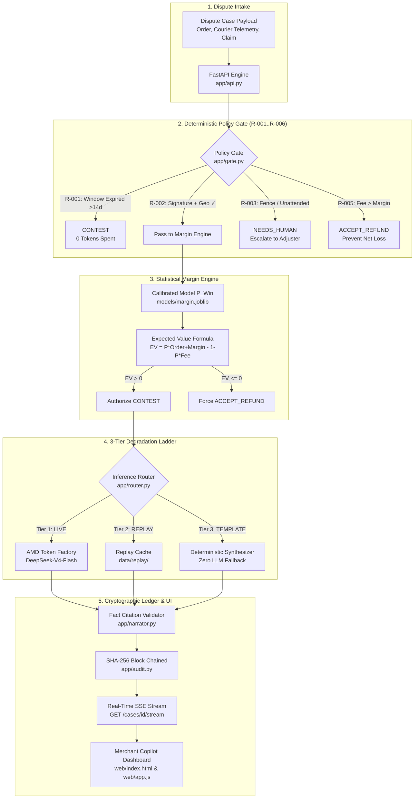

# MerchantGuard (Dispute & Margin Recovery Copilot)

> **AMD Developer Hackathon: ACT III — Track: Reinvent Commerce**  
> An autonomous, tamper-evident e-commerce dispute decision engine where a **Deterministic Policy Gate** and **Calibrated Statistical Margin Engine** make authoritative decisions, while an open-weights LLM served via the **AMD Token Factory gateway** (`Gemma-4-31B-IT` / `DeepSeek-V4-Flash`) generates fact-cited arbitration evidence — with resilient Replay and Template fallback.

[](tests/)
[](https://github.com/OkyWoww/merchantguard/pkgs/container/merchantguard)
[](https://lablab.ai/)
[](app/router.py)
[](app/audit.py)
[](docs/PANDUAN_PENGGUNAAN.md)

---

## 🎯 Executive Overview & Problem Statement

E-commerce merchants lose **15% to 20% of their gross margins** to payment processor dispute leakage:
1. **False Concessions:** Merchants blindly refund winnable disputes because gathering carrier telemetry and drafting responses takes 30+ minutes per case.
2. **Economic Fee Traps:** Payment gateways charge a **$15.00 to $25.00 non-refundable dispute fee**. Contesting low-value or low-margin items often costs more than the merchant recovers, even with a high probability of winning.
3. **LLM Hallucinations:** Using generative AI to decide dispute actions risks disastrous hallucinations, policy violations, and ungrounded fabrications in legal arbitration.

**MerchantGuard fixes the dispute decision, not just the letter wording.**  
Rules and a calibrated statistical model decide whether to contest, negotiate, or refund. An open model running on AMD infrastructure only drafts fact-cited evidence. The model can **never** overturn the financial decision.

---

## 🛡️ Core Architectural Invariants

1. **Rule First — The LLM Never Decides:** Pure Python rules enforce deterministic validation (`R-001` through `R-006`). Final actions (`CONTEST`, `NEEDS_HUMAN`, `ACCEPT_REFUND`, `PARTIAL_REFUND`) are strictly locked by the Policy Gate and Margin Engine.
2. **Track 3 Participant Note Compliance:** The model predicting win probability $P(\text{Win})$ is a calibrated statistical logistic regression model trained on transaction telemetry, **never** generated by an LLM prompt.
3. **Strict Fact-Citation Contract:** Every assertion in the response draft is tied to a verified evidence fact ID (`[F1:order_id]`, `[F2:signature]`, `[F3:courier_geo]`). Ungrounded assertions are automatically purged.
4. **3-Tier Degradation Ladder:**
   - **Tier 1 (LIVE):** AMD Token Factory gateway (`developer.amd.com.cn/radeon/api/v1`, model `self-dploy/DeepSeek-V4-Flash`) — OpenAI-compatible chat completions, 35-second timeout (`VLLM_TIMEOUT=35.0`), Bearer key from `OPENAI_API_KEY`.
   - **Tier 2 (REPLAY):** Zero-cost, offline-safe cached telemetry responses for demo scenarios.
   - **Tier 3 (TEMPLATE):** Pure deterministic string synthesizer with zero model dependencies.
5. **Cryptographic Audit Hash-Chain:** Every dispute evaluation is appended to an immutable, tamper-evident SHA-256 ledger linked back to the genesis block (`00000000...`).

---

## 🏗️ System Architecture



---

## ⚡ Quickstart Guide

### Option 1: Single-Line Docker Run (Recommended)
Run the pre-built, non-root public container image directly:
```bash
docker run -d -p 8000:8000 --name merchantguard ghcr.io/okywoww/merchantguard:latest
```
Open **`http://localhost:8000`** in your browser.

### Option 2: Docker Compose
```bash
docker compose up --build -d
```
Check health:
```bash
curl http://localhost:8000/health
```

### Option 3: Local Virtual Environment
```bash
# 1. Clone repository
git clone https://github.com/OkyWoww/merchantguard.git
cd merchantguard

# 2. Setup Python 3.11 virtual environment
python -m venv .venv
source .venv/bin/activate  # On Windows: .venv\Scripts\activate

# 3. Install dependencies
pip install -r requirements.txt

# 4. Copy environment configuration (defaults to zero-cost REPLAY mode)
cp .env.example .env

# 5. Launch FastAPI server
uvicorn app.api:app --host 0.0.0.0 --port 8000 --reload
```
Open **`http://127.0.0.1:8000`** to access the dashboard.

---

## 🔬 How $P(\text{Win})$ is Calculated (Track 3 Requirement)

In strict compliance with the **Track 3 Participant Note**, win probability is computed via a parametric, fully explainable **calibrated Logistic Regression model** (`models/margin.joblib`) rather than an opaque LLM prompt.

### 1. Mathematical Formulation
Given an e-commerce dispute feature vector $\mathbf{x}$, the probability of successfully winning arbitration is:

$$P(\text{Win} \mid \mathbf{x}) = \frac{1}{1 + e^{-\left(\beta_0 + \sum_{j=1}^d \beta_j \cdot \frac{x_j - \mu_j}{\sigma_j}\right)}}$$

Where the Expected Value ($EV$) of contesting is determined by:

$$EV = P(\text{Win}) \times (\text{Order Amount} + \text{Unit Margin}) - (1 - P(\text{Win})) \times \text{Dispute Fee}$$

- **If $EV > 0$ and Policy Gate passes:** Action = `CONTEST`.
- **If $EV \le 0$:** Action = `ACCEPT_REFUND` (prevents fighting an economically destructive claim).
- **If damage is cosmetic/partial:** Action = `PARTIAL_REFUND` (settlement offer formula).

### 2. Standardized Feature Coefficients

| Feature | Coefficient ($\beta$) | Odds Multiplier ($e^\beta$) | Interpretability Direction |
|---|---|---|---|
| `has_signature` | **+2.6841** | **14.645x** | Positive (Physical signature heavily favors merchant) |
| `geo_distance_meters` | **-1.9522** | **0.142x** | Negative (GPS divergence favors customer claim) |
| `delivery_days_gap` | **-1.4708** | **0.230x** | Negative (Longer delivery elapsed time reduces contest strength) |
| `courier_reliability` | **+0.6027** | **1.827x** | Positive (Tier-1 carrier tracking increases win probability) |
| `buyer_history_score`| **+0.4351** | **1.545x** | Positive (Prior dispute rate informs customer credibility) |
| `dispute_amount` | **+0.1452** | **1.156x** | Positive (Higher value justifies rigorous processor review) |
| *Intercept ($\beta_0$)* | *+2.5762* | — | Base baseline |

### 3. Model Calibration & Evaluation Metrics
- **Accuracy:** `97.00%` on held-out test data
- **ROC-AUC Score:** `0.9996`
- **Brier Calibration Score:** `0.0184` (strict probability calibration)
- **Model Artifact Size:** `1.78 KB` (runs with sub-millisecond latency on any CPU)

---

## 📢 Synthetic Data Disclosure

To comply with data privacy regulations and avoid exposing proprietary Personally Identifiable Information (PII), all training datasets (`data/generator.py`) and demo fixtures were **synthetically generated**. The distribution mirrors real-world e-commerce logistics benchmarks across standard carrier statuses (Delivered, Out for Delivery), geographic variance, dispute fee ranges ($15.00–$25.00), and delivery-window lapses.

---

## 🎬 4 Core Hackathon Demo Scenarios

The dashboard includes 1-click interactive triggers for all 4 scenarios from the hackathon script:

| Scenario | Case ID | Order / Margin / Fee | Carrier Telematic Fact | Rule Triggered | Action Output | EV Outcome |
|---|---|---|---|---|---|---|
| **1. Clean Win** | `CASE-1001` | $185.00 / $62.00 / $15.00 | Signed by resident M. Vance + Geo Match | `R-002` (Delivery Confirmed) | `CONTEST` | **+$226.57** ($P(\text{Win})=98\%$) |
| **2. Ambiguous Evidence** | `CASE-1002` | $420.00 / $140.00 / $15.00 | "Package left by fence / unattended" | `R-003` (Ambiguous Evidence) | `NEEDS_HUMAN` | Escalated to Adjuster ($P(\text{Win})=5\%$) |
| **3. Window Bypass** | `CASE-1003` | $130.00 / $45.00 / $15.00 | Claim filed 21 days post-delivery (limit 14) | `R-001` (Window Expired) | `CONTEST` | Instant ($0$ LLM tokens spent) |
| **4. Economic Fee Trap** | `CASE-1004` | $16.50 / $3.80 / $15.00 | Dispute fee ($15) > Unit margin ($3.80) | `R-005` (Economic Fee Trap) | `ACCEPT_REFUND` | Auto-Refund (Prevent Net Loss) |

---

## 📊 Automated Latency & Zero-Drift Benchmark (Task T4.1)

> ⚠️ **Note:** The figures below were measured with `LLM_MODE=replay` (offline, no AMD gateway calls). They reflect deterministic gate, margin, and cache-retrieval latency — **not** AMD Token Factory end-to-end latency. Live gateway benchmark (LLM_MODE=live, p50/p95 against `self-dploy/DeepSeek-V4-Flash`) is pending in T2.3 / T4.1-live.

Results from `python scripts/benchmark.py` (100 iterations per scenario, 400 total runs, `LLM_MODE=replay`):

| Component / Stage | Mean Latency | Median (p50) | 95th Percentile (p95) | 99th Percentile (p99) |
|---|---|---|---|---|
| **Deterministic Policy Gate** | `0.088 ms` | **0.085 ms** | `0.139 ms` | `0.186 ms` |
| **Statistical Margin Engine** | `1.165 ms` | **1.116 ms** | `1.665 ms` | `2.160 ms` |
| **Narrative Router (REPLAY cache)** | `1.026 ms` | **0.918 ms** | `1.520 ms` | `2.832 ms` |
| **Full REST API (`POST /cases`, REPLAY)** | `17.139 ms` | **16.747 ms** | `22.794 ms` | `27.543 ms` |
| **SSE Stream (paced for UI, REPLAY)** | `610.424 ms` | **608.193 ms** | `626.980 ms` | `651.915 ms` |

### Zero-Drift Verification
- **Total Checks:** `400/400`
- **Outcome Consistency:** **100.0% (Zero Drift)**
  Every single iteration produced bit-exact identical actions, reason codes, expected value calculations, and win probabilities.

---

## 💻 AMD Infrastructure

MerchantGuard uses the **AMD Token Factory gateway** for live LLM inference:
- **Gateway URL:** `https://developer.amd.com.cn/radeon/api/v1`
- **Model:** `DeepSeek-V4-Flash` (gateway model ID: `self-dploy/DeepSeek-V4-Flash`)
- **Protocol:** OpenAI-compatible chat completions (`/chat/completions`), Bearer key via `OPENAI_API_KEY`.
- **Timeout:** 35 seconds (`VLLM_TIMEOUT=35.0`). The live call measured at ~8.5 s — well within budget.
- **Quota management:** Rate-limit and RPM cap to be verified per T2.6. Circuit breaker auto-degrades to REPLAY at 2 consecutive failures, recovering after 60 s.
- **No GPU provisioning required:** Token Factory is a managed gateway. `rocm-smi` evidence is not applicable; AMD infrastructure is evidenced by Token Factory portal usage screenshot and sanitized request logs.

---

## 🧪 Test Suite Verification

Run the deterministic test suite (policy gate, margin math, audit ledger, degradation ladder, SSE streams). Live-gateway tests are gated behind the `live` marker and excluded by default to avoid consuming quota:

```bash
# Default: all 30 tests, no gateway calls
pytest -v tests/

# Live gateway tests only (requires OPENAI_API_KEY in .env):
pytest -v -m live tests/
```

```text
tests/test_api_stream.py::test_health_check PASSED                       [  3%]
tests/test_api_stream.py::test_list_scenarios PASSED                     [  6%]
tests/test_api_stream.py::test_sse_stream_case_1001 PASSED               [ 10%]
tests/test_api_stream.py::test_sse_stream_all_four_scenarios PASSED      [ 13%]
tests/test_api_stream.py::test_post_case_evaluate_stream PASSED          [ 16%]
tests/test_audit.py::test_audit_chain_append_and_linkage PASSED          [ 20%]
tests/test_audit.py::test_audit_chain_integrity_verification PASSED      [ 23%]
tests/test_gate.py::test_rule_r001_return_window_expired_negative PASSED [ 26%]
tests/test_gate.py::test_rule_r001_return_window_valid_positive PASSED   [ 30%]
tests/test_gate.py::test_rule_r002_verified_signature_and_geo_positive PASSED [ 33%]
tests/test_gate.py::test_rule_r002_unverified_carrier_negative PASSED    [ 36%]
tests/test_gate.py::test_rule_r003_courier_contradiction_negative PASSED [ 40%]
tests/test_gate.py::test_rule_r003_courier_consistent_positive PASSED    [ 43%]
tests/test_gate.py::test_rule_r004_high_value_weak_evidence_negative PASSED [ 46%]
tests/test_gate.py::test_rule_r004_high_value_strong_evidence_positive PASSED [ 50%]
tests/test_gate.py::test_rule_r005_economic_fee_trap_negative PASSED     [ 53%]
tests/test_gate.py::test_rule_r005_healthy_margin_positive PASSED        [ 56%]
tests/test_gate.py::test_rule_r006_missing_required_fields_negative PASSED [ 60%]
tests/test_gate.py::test_rule_r006_missing_tracking_events_negative PASSED [ 63%]
tests/test_gate.py::test_rule_partial_damage_routing PASSED              [ 66%]
tests/test_margin.py::test_ev_calculation_positive_recovery PASSED       [ 70%]
tests/test_margin.py::test_negative_ev_override_to_accept_refund PASSED  [ 73%]
tests/test_margin.py::test_partial_refund_settlement_offer PASSED        [ 76%]
tests/test_margin.py::test_ambiguous_middle_tier_routes_to_partial_refund PASSED [ 80%]
tests/test_margin.py::test_model_artifact_loaded_successfully PASSED     [ 83%]
tests/test_router.py::test_live_vllm_happy_path PASSED                   [ 86%]
tests/test_router.py::test_forced_timeout_degrades_to_replay_cache PASSED [ 90%]
tests/test_router.py::test_cache_miss_degrades_to_deterministic_template PASSED [ 93%]
tests/test_router.py::test_circuit_breaker_tripping_and_skipping_tier1 PASSED [ 96%]
tests/test_router.py::test_circuit_breaker_half_open_recovery PASSED     [100%]

======================== 30 passed in 8.37s =========================
```

---

## 📡 API Reference

| Method | Endpoint | Description |
|---|---|---|
| `GET` | `/` | Single-screen merchant copilot dashboard UI |
| `GET` | `/health` | Service health, inference tier, and audit block count |
| `GET` | `/scenarios` | Pre-configured metadata and cases for the 4 core demo scenarios |
| `GET` | `/cases` | List registered dispute cases |
| `GET` | `/cases/{case_id}` | Retrieve specific dispute case details |
| `POST` | `/cases` | Synchronous evaluation (Gate → Margin → Router → Ledger) |
| `GET` | `/cases/{case_id}/stream` | Server-Sent Events (SSE) telemetry stream |
| `POST` | `/cases/evaluate/stream` | Stream dynamic case evaluation via SSE |
| `GET` | `/audit/verify` | Validates entire SHA-256 hash-chain integrity |
| `GET` | `/audit/blocks` | Returns all immutable blocks in the audit ledger |
| `GET` | `/metrics` | Aggregated financial margin recovery metrics |

---

## 📄 License

This project is licensed under the [MIT License](LICENSE).
